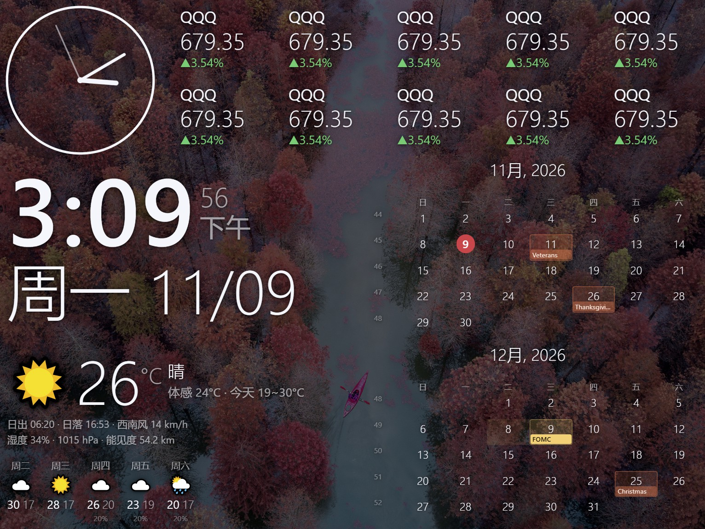

# HomeDashboard

Turn an idle monitor into a family information display. A local Node server aggregates all data sources; a fullscreen browser tab becomes a dashboard showing:

- **Clock** — digital (12-hour with Chinese day-period or plain) and a minimal analog dial, always second-accurate in the browser's timezone
- **Calendar** — two-month view, ISO week numbers, US federal holidays, macro calendar (FOMC decision dates with highlighted meeting windows, market-moving Fed appearances, and principal US data releases: payrolls, CPI, PPI, ECI, JOLTS)
- **Weather** — current conditions, details (sunrise/sunset, wind, humidity, pressure, visibility) and a multi-day forecast; Open-Meteo primary, NWS fallback, Chinese text
- **Stocks** — US equities, index (^GSPC style) and crypto quotes from Yahoo Finance, as a fixed tape or a grid, green-up/red-up configurable
- **Wallpaper** — five keyless libraries (NASA ~6k, Bing with a 2.9k-day archive, Wallhaven, Wikimedia Commons, ESO) merged into one hourly-rotating pool that never repeats inside ~20 days, plus a generative starry-sky fallback

All sources are free and need no API key. Everything runs on one machine; responses are disk-cached so the display degrades gracefully (stale badges) instead of breaking when the network drops.



## Install

Requires Node.js ≥ 20.

```bash
npm install
copy config\dashboard.example.json config\dashboard.json   # Windows
# cp config/dashboard.example.json config/dashboard.json   # macOS / Linux
```

Edit `config/dashboard.json` for your timezone, city and watchlist, then:

```bash
npm run build
npm start        # http://localhost:8787
```

Development mode (hot reload, `/api` proxied to the server):

```bash
npm run dev      # server: tsx watch · web: vite (http://localhost:5173)
```

## Configuration

Layout and content live entirely in `config/dashboard.json`. The server hot-reloads it by file mtime — save the file and refresh the page.

**Privacy:** `config/dashboard.json` (your ZIP code, watchlist, calendar URLs) and `config/events.json` are gitignored and never leave your machine; the repo only ships the sanitized template `config/dashboard.example.json`. The `data/` directory (geocoding, weather/quote caches, downloaded wallpapers) is gitignored too.

| Key | Meaning |
|-----|---------|
| `timezone` / `locale` | Clock/date timezone (e.g. `America/New_York`) and text locale (`zh-CN`) |
| `theme.background` | `mix` (hourly rotation over the merged pool of all five libraries — NASA, Bing incl. ~16 years of history, Wallhaven, Wikimedia Commons, ESO — sized-proportional, no image repeats within ~20 days; a library being offline doesn't stop rotation) · `bing-daily` (today's Bing image, switches at midnight) · `bing-rotate` (hourly over the whole Bing archive, ~2.9k images) · `nasa-rotate` (hourly over the NASA library) · `starry` (built-in generative sky) |
| `theme.backgroundMarket` | Bing market, default `en-US` (`zh-CN` for the Chinese feed) |
| `theme.backgroundImage` | Path/URL of a custom image; overrides every mode above |
| `theme.changeColors` | `green-up` (default) or `red-up` (Chinese convention) |
| `location` | `zip` (US ZIP, resolved via zippopotam, cached in `data/geo.json`) or `name` (Open-Meteo geocoding), or explicit `lat`/`lon` |
| `widgets[]` | Each widget: `type` + `area` (grid line coordinates on a 12×7 CSS grid, `[start, end)`) + `options` |

Widget types and their `options`:

- `clock` — `seconds`, `dateLine`, `lunar`
- `analog-clock` — `style` (`ring`), `secondsHand`
- `weather` — `details` (`sunrise`/`wind`/`humidity`/`pressure`/`visibility`), `forecastDays` (default 5), `units` (`imperial`/`metric`)
- `stocks` — `symbols` (`[{code, label?}]`, Yahoo codes, `^` prefix for indices, `label` overrides the display text, e.g. `BTC-USD` → `BTC`), `style` (`tape` = fixed quote rows, `quotesPerRow` per row (default 3), no scrolling / `grid` = `columnsPerRow`)
- `calendar` — `months` (default 2), `weekNumbers`, `showHolidays`, `showFed` (FOMC + market-moving speech chips, on by default), `showData` (data release chips, on by default)

## Deployment

For a monitor that stays on 24/7:

```bash
npm run build && npm start
```

One port (8787) serves both the static frontend and the aggregating API, so any device on the LAN can open `http://<this-machine>:8787`. Press `F11` in the browser (or launch Chrome/Edge with `--kiosk http://localhost:8787`) for a chromeless fullscreen display. Disable display sleep/hibernate on the machine, and put the start command in your login autostart (Windows: Task Scheduler or a `startup` folder shortcut) if you want it to come back after a reboot.

The kiosk browser never touches the internet directly: all external fetches (Bing, NASA, Wallhaven, Wikimedia Commons, ESO, Open-Meteo, Yahoo, NWS, federalreserve.gov, bls.gov) go through the local server, which keeps disk caches under `data/`, so short network outages just show a "stale" badge with the last known data.

### Portable package

```bash
npm run release             # release/HomeDashboard-portable.zip — ~33 MB, bundles runtime/node.exe
npm run release:small       # release/HomeDashboard-small.zip — a few MB, needs Node.js ≥ 20 on the target
```

Both packages unpack to a folder named `HomeDashboard` and carry the bundled `server.mjs`, `web/dist`, the `start-*.bat` launchers and your config. `start.bat` uses `runtime\node.exe` when it exists and falls back to `node` on `PATH`, which is why the small build is complete apart from Node itself. The two tools share the staging folder `release/HomeDashboard` (it always matches the last build) but write separate zips, so neither build throws away the other package. Either one includes your personal `config/dashboard.json` and `data/` caches — copy it between your own machines, never upload it.

---

# HomeDashboard（中文）

把闲置显示器变成家庭信息屏。本地 Node 服务聚合所有数据源，全屏浏览器即一块 dashboard，显示：

- **时钟** — 数字时钟（12 小时制 + 中文时段）与极简表盘，浏览器端逐秒走时
- **日历** — 双月视图、ISO 周号、美国联邦假日、宏观日历（FOMC 决议与会议区间高亮、影响市场的美联储官员露面、美国主要经济数据发布：非农、CPI、PPI、ECI、JOLTS）
- **天气** — 实况、明细（日出日落/风/湿度/气压/能见度）与多日预报；Open-Meteo 主源、NWS 备源，中文文案
- **行情** — Yahoo Finance 美股/指数（`^` 前缀）/加密货币，固定行情条或网格，红涨绿跌可配
- **壁纸** — NASA、Bing（含约 16 年历史存档）、Wallhaven、维基共享资源、ESO 五个免 key 图库合并成一个整点轮换大池,约 20 天内不重样,内置生成式星空兜底

所有数据源免费、无需 API key。单机运行，响应带磁盘缓存，断网时显示"陈旧"角标和最后一次成功数据，而不是白屏。


## 安装

需要 Node.js ≥ 20。

```bash
npm install
copy config\dashboard.example.json config\dashboard.json   # Windows
# cp config/dashboard.example.json config/dashboard.json   # macOS / Linux
```

编辑 `config/dashboard.json` 设置时区、城市和自选品种，然后：

```bash
npm run build
npm start        # http://localhost:8787
```

开发模式（前端热更新，`/api` 代理到服务端）：

```bash
npm run dev      # server: tsx watch · web: vite (http://localhost:5173)
```

## 配置

布局与内容全部在 `config/dashboard.json`，服务端按文件 mtime 热加载，保存后刷新页面即生效。

**隐私：** `config/dashboard.json`（邮编、自选品种、日历地址）与 `config/events.json` 已在 `.gitignore` 中排除，永远只留在本地；仓库只提供脱敏模板 `config/dashboard.example.json`。`data/`（地理编码、天气/行情缓存、壁纸缓存）同样不入库。

| 配置项 | 说明 |
|--------|------|
| `timezone` / `locale` | 走时与日期文案的时区（如 `America/New_York`）与语言（`zh-CN`） |
| `theme.background` | `mix`（每小时从五个图库——NASA、Bing（含约 16 年历史）、Wallhaven、维基共享、ESO——的合并池里换一张,按池大小加权、约 20 天内不重样;单个图库断网不影响轮换）/ `bing-daily`（Bing 每日一图，午夜随 Bing 换图）/ `bing-rotate`（Bing 历史全池约 2900 张每小时轮换）/ `nasa-rotate`（NASA 图像库每小时自动换图）/ `starry`（内置生成式星空） |
| `theme.backgroundMarket` | Bing 市场，默认 `en-US`（`zh-CN` 换中文版图源） |
| `theme.backgroundImage` | 指定本地图片，覆盖以上全部模式 |
| `theme.changeColors` | `green-up`（默认）/ `red-up`（中式红涨绿跌） |
| `location` | `zip`（美国邮编，zippopotam 解析并缓存于 `data/geo.json`）或 `name`（Open-Meteo 地理编码），也可直接给 `lat`/`lon` |
| `widgets[]` | 每个 widget：`type` + `area`（12 列 × 7 行 CSS 网格线坐标，`[start, end)`）+ `options` |

各 widget 类型的 `options`：

- `clock` — `seconds`、`dateLine`、`lunar`
- `analog-clock` — `style`（`ring`）、`secondsHand`
- `weather` — `details`（`sunrise`/`wind`/`humidity`/`pressure`/`visibility`）、`forecastDays`（默认 5）、`units`（`imperial`/`metric`）
- `stocks` — `symbols`（`[{code, label?}]`，Yahoo 代码，指数加 `^`，`label` 覆盖界面显示文字，如 `BTC-USD` 显示为 `BTC`）、`style`（`tape` 固定行情条，每行 `quotesPerRow`（默认 3）个品种、不滚动 / `grid` 网格配 `columnsPerRow`）
- `calendar` — `months`（并排月数，默认 2）、`weekNumbers`、`showHolidays`、`showFed`（FOMC 与"影响市场的官员露面"标签，默认开）、`showData`（数据发布标签，默认开）

## 部署

7×24 挂机：

```bash
npm run build && npm start
```

单端口（8787）同时提供静态页面与聚合 API，局域网内任意设备打开 `http://<本机>:8787` 即可。浏览器按 `F11` 全屏（或用 `--kiosk http://localhost:8787` 启动 Chrome/Edge）得到无边框信息屏。关闭系统的显示器休眠与睡眠；需要重启后自动恢复的话，把启动命令加入登录自启动（Windows：任务计划程序或 `startup` 文件夹快捷方式）。

全屏浏览器不直接访问外网：所有外部请求（Bing、NASA、Wallhaven、维基共享资源、ESO、Open-Meteo、Yahoo、NWS、federalreserve.gov、bls.gov）都由本地服务端代理，磁盘缓存保存在 `data/` 下，短暂断网只会显示"陈旧"角标和最后一次成功数据。

### 便携包

```bash
npm run release             # release/HomeDashboard-portable.zip，约 33 MB，自带 runtime\node.exe
npm run release:small       # release/HomeDashboard-small.zip，几 MB，目标机需自装 Node.js ≥ 20
```

两种产物解压后都叫 `HomeDashboard` 目录，内容一致（打包好的 `server.mjs`、`web/dist`、启动脚本与配置）。`start.bat` 优先使用 `runtime\node.exe`，没有就回退到系统 PATH 里的 `node`，所以小包除了 Node 本身什么都不缺。两个脚本共用暂存目录 `release/HomeDashboard`（目录内容始终是最后一次打包的结果），但各写各的 zip，打其中一个不会删掉另一个包。包内含你的个人 `config/dashboard.json` 与 `data/` 缓存，只在自己设备间拷贝，不要上传。
